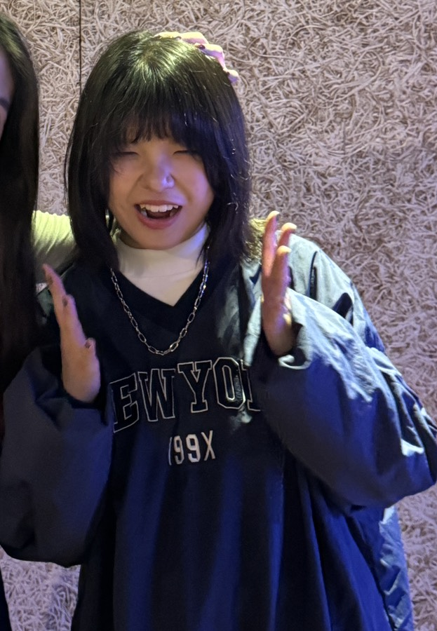
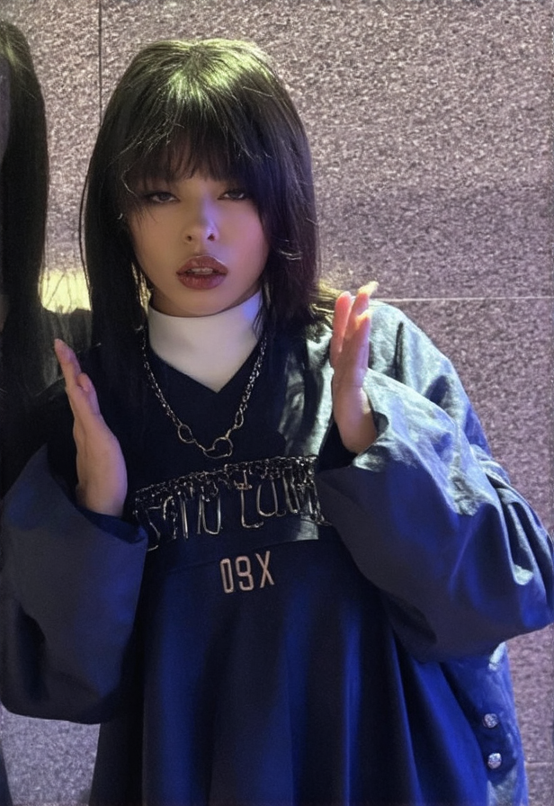
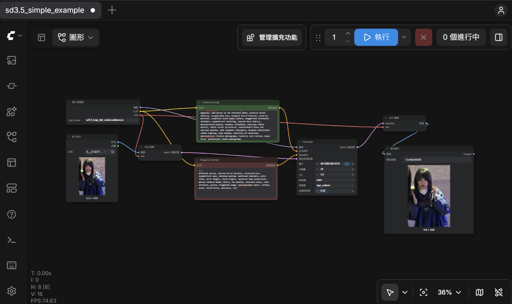

### 網址:https://jjuyun.github.io/1152029_comfy/
### 原圖

### 生成的圖

### 工作流程

---

## 提示詞

### Positive Prompt（正向提示詞）

dark avant-garde fashion editorial, high-end alternative fashion magazine, same person as the reference photo, preserve facial identity, recognizable face, original facial features, waist-up portrait, sculptural black haute couture, exaggerated structured shoulders, asymmetrical tailoring, layered black fabrics, deconstructed fashion, dramatic silhouette, intricate fabric details, subtle silver accessories, monochromatic black and charcoal palette, cold cinematic atmosphere, dramatic directional studio lighting, deep shadows, editorial art direction, photorealistic fashion photography, realistic skin texture, sharp focus, professional studio photography

### Negative Prompt（反向提示詞）

different person, altered facial features, distorted face, asymmetrical eyes, deformed anatomy, malformed shoulders, extra limbs, extra fingers, fused fingers, unnatural body proportions, poorly rendered hands, blurry, low quality, excessive noise, color artifacts, glitch, fragmented image, oversaturated colors, cartoon, anime, illustration, watermark, text

## 心得與反思
我覺得實際操作很複雜，怎樣生成都跟想像中的差很多，有時候還會變成一堆色塊，調整過參數很多次，發現步驟數跟dnoise會影響比較多，然後提示詞太多好像也會影響判斷。我使用比較小的模型，這部分可能也影響成效很大一部分，使用較大較新的摩緒或許會比較符合理想。其實一開始找不到要怎麼有模型花很多時間。
